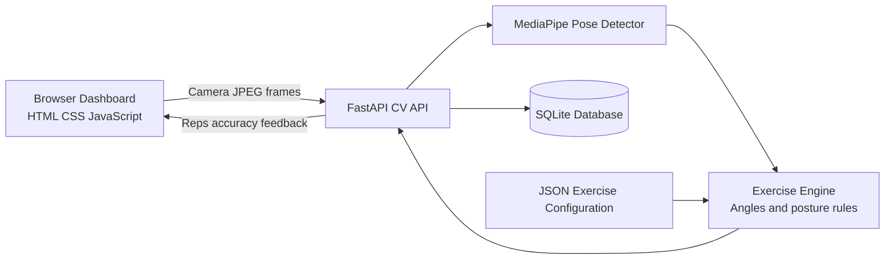

# IntelliFit

## AI-Powered Fitness Coach

IntelliFit is a browser-based workout platform that uses webcam video, MediaPipe pose landmarks, and angle-based movement analysis to count repetitions and provide real-time posture feedback without wearable devices.

The application combines a guided workout dashboard with a Python computer-vision service. Users can browse exercise demonstrations, start a camera-based coaching session, receive movement feedback, and save completed sessions for progress tracking.

## Overview

People exercising at home often lack access to equipment, a personal trainer, or a reliable way to measure repetitions and maintain proper form. IntelliFit addresses this by bringing workout guidance and computer-vision feedback into one accessible home-training experience.

The browser captures camera frames and sends them to a FastAPI backend. The backend detects body landmarks, calculates joint angles, evaluates exercise-specific posture rules, counts valid repetitions, and returns feedback to the dashboard.

## Features

### Guided Workouts

- Exercise categories for Chest, Shoulders, Abs, Biceps, and Legs
- Demonstration videos and images
- Exercise instructions and movement descriptions
- Difficulty indicators
- Estimated calories and session duration
- Set timers and set-completion controls
- Exercise queue and workout progression

### AI Form Coach

- Browser webcam integration
- Real-time pose detection using MediaPipe
- OpenCV frame processing
- Automatic repetition counting
- Attempted-repetition tracking
- Clean-repetition tracking
- Target repetition configuration
- Exercise-stage detection
- Form accuracy scoring
- Annotated pose skeletons
- Live posture feedback

Live computer-vision rules currently support:

- **Bicep Curl**: arm extension, curl height, and elbow-angle analysis
- **Squat**: squat depth, torso angle, forward lean, and knee alignment

The dashboard includes additional guided exercises that can be expanded with future pose-analysis rules.

### Progress Tracking

- SQLite workout-session storage
- Workout duration tracking
- Total repetitions
- Clean repetitions
- Accuracy percentages
- Current workout streak
- Longest streak
- Total workout count
- Analytics API

### Product Views

The dashboard includes frontend views for:

- Home workout dashboard
- AI Coach
- Community
- Settings
- Analytics

The Community, Settings, and visual Analytics views currently provide the product experience and interface foundation. Their user accounts, social data, preferences persistence, and live analytics integration can be extended through the backend.

## Architecture



## Technology Stack

| Technology | Purpose |
| --- | --- |
| HTML, CSS, JavaScript | Responsive browser dashboard and navigation |
| Bootstrap Icons | Interface icons |
| Node.js and `serve` | Local frontend development server |
| Python | Computer-vision and backend implementation |
| FastAPI | HTTP API for workout sessions and frame processing |
| Uvicorn | ASGI development server |
| OpenCV | Image decoding, frame processing, and annotated output |
| MediaPipe Pose | 33-point body landmark detection |
| NumPy | Joint-angle and movement calculations |
| SQLite | Local session and streak persistence |
| JSON | Exercise thresholds and posture-rule configuration |
| gTTS / playsound | Optional voice-coaching module |

## Project Structure

```text
Intellifit Workout/
├── index.html                 # Public landing page
├── style.css                  # Landing-page styles
├── script.js                  # Landing-page interactions and 3D model setup
├── dashboard.html             # Workout dashboard and product views
├── dashboard.css              # Dashboard design system and responsive styles
├── dashboard.js               # Workout logic, navigation, and camera client
├── Exercises/                 # Exercise demonstration media
├── models/                    # 3D workout model assets
├── logo.svg                   # IntelliFit brand mark
├── package.json               # Frontend scripts and dependencies
├── package-lock.json          # Locked Node dependency versions
│
└── AI Coach/
    ├── api.py                 # FastAPI application
    ├── requirements.txt       # Python dependencies
    ├── core/
    │   ├── pose_detector.py   # MediaPipe and OpenCV pose processing
    │   └── exercise_engine.py # Rep counting and posture state machine
    ├── config/
    │   └── exercises.json     # Exercise stages and posture rules
    ├── database/
    │   └── db_manager.py      # SQLite session and streak operations
    ├── feedback/
    │   └── voice_coach.py     # Optional asynchronous voice feedback
    ├── analytics/              # Analytics helpers
    ├── gamification/           # Badge and milestone logic
    ├── utils/                  # Configuration and export utilities
    └── data/                   # Local runtime database and exports
```

## Requirements

- Python 3.10 or another Python version supported by the pinned MediaPipe release
- Node.js and npm
- A modern browser with webcam support
- A connected webcam for AI coaching
- Camera permission enabled for the local frontend URL

MediaPipe installation is most reliable with Python 3.10 or 3.11.

## Installation

### 1. Clone the repository

```bash
git clone <repository-url>
cd "Intellifit Workout"
```

### 2. Create a Python virtual environment

Windows PowerShell:

```powershell
python -m venv .venv
.venv\Scripts\Activate.ps1
```

macOS or Linux:

```bash
python3 -m venv .venv
source .venv/bin/activate
```

### 3. Install backend dependencies

```bash
python -m pip install -r "AI Coach/requirements.txt"
```

### 4. Install frontend dependencies

From the project root:

```bash
npm install
```

## Running the Application

The frontend and backend run in separate terminals.

### Terminal 1: Start the CV backend

From the project root:

```bash
cd "AI Coach"
python -m uvicorn api:app --reload --host 127.0.0.1 --port 8000
```

The backend is available at:

```text
http://127.0.0.1:8000
```

Health check:

```text
http://127.0.0.1:8000/api/health
```

### Terminal 2: Start the frontend

From the project root:

```bash
npm run dev
```

Open the local URL printed by `serve`, then select **Login** to open the dashboard.

If port 3000 is already in use, `serve` automatically selects another available port.

## Using the AI Coach

1. Start the FastAPI backend.
2. Start the frontend server.
3. Open the dashboard.
4. Select **AI Form Coach** on the Home view or open the AI Coach page from the vertical navigation.
5. Choose **Bicep Curl** or **Squat**.
6. Set a target repetition count.
7. Select **Start AI Coach**.
8. Allow webcam access.
9. Stand far enough away for your full body to remain visible.
10. Follow the live repetition and posture feedback.
11. Select **Stop & Save** to persist the workout session.

For best results, use good lighting, keep the camera stable, and wear clothing that makes body movement easy to distinguish.

## API Reference

| Method | Endpoint | Description |
| --- | --- | --- |
| `GET` | `/api/health` | Confirms that the CV service is running |
| `GET` | `/api/exercises` | Returns supported CV exercises |
| `POST` | `/api/sessions` | Creates a workout session |
| `POST` | `/api/sessions/{session_id}/frames` | Processes a camera frame |
| `POST` | `/api/sessions/{session_id}/stop` | Stops and saves a workout session |
| `GET` | `/api/analytics` | Returns saved sessions and streak data |

## Configuration

Exercise behavior is configured in:

```text
AI Coach/config/exercises.json
```

Configuration includes:

- Exercise display names
- Target repetitions
- Movement stages
- Joint landmark mappings
- Angle thresholds
- Posture rules
- Feedback messages
- MediaPipe confidence settings
- Skeleton colors
- Badge definitions

This allows exercise thresholds and posture feedback to be tuned without changing the core engine.

## Current Scope

The current implementation provides a functional live CV flow for Bicep Curls and Squats. The guided dashboard contains additional exercise content, but those exercises require their own landmark mappings, movement stages, and posture rules before they can be analyzed by the live coach.

The Community, Settings, and visual Analytics screens are currently frontend-first views. The backend already exposes session and streak data through `/api/analytics`, providing a foundation for connecting those screens to live user data.

## Troubleshooting

### The dashboard says the API is unavailable

Make sure the backend is running in the `AI Coach` directory:

```bash
python -m uvicorn api:app --reload --host 127.0.0.1 --port 8000
```

### The webcam does not start

- Allow camera permission in the browser.
- Confirm that another application is not using the webcam.
- Use `localhost` or `127.0.0.1` instead of opening the HTML file directly.
- Ensure the browser is using the intended camera.

### MediaPipe installation fails

Use Python 3.10 or 3.11 and reinstall the dependencies inside a fresh virtual environment.

### The frontend does not start with `npm run dev`

Install the Node dependencies from the project root:

```bash
npm install
```

Then run:

```bash
npm run dev
```

## Development Guidelines

- Keep exercise thresholds in `AI Coach/config/exercises.json`.
- Reuse the existing dashboard color palette and spacing system.
- Keep frontend and backend changes independently testable.
- Do not commit virtual environments, databases, logs, caches, or secrets.
- Add a focused validation step when changing pose-analysis logic.


## License

This project is developed for academic purposes.
